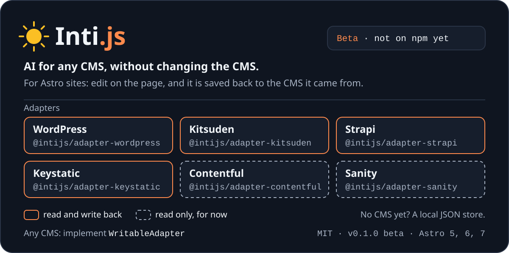

<p align="center">
  
</p>

<p align="center">
  <a href="https://github.com/intijs/inti/actions/workflows/ci.yml"></a>
  
  <a href="LICENSE"></a>
</p>

# Inti.js

**AI for any CMS, without changing the CMS.**

Inti modernizes the website, not the CMS. Your site moves to [Astro](https://astro.build); your content stays where it is (WordPress, Kitsuden, Strapi, Keystatic…), and editors keep their admin. On top of it you get editing on the page itself and AI components: a model that composes sections from your own blocks, personalization per visitor, and agents that edit through the same rules.

> **Inti is for sites built with Astro.** It is not a plugin you install inside WordPress or any other CMS, and it does not change your CMS's admin. If your site is still rendered by a WordPress theme, the first step is moving the frontend to Astro, and Inti is how you do it without migrating the content.

Edit your content *directly on your Astro page* — double-click a heading, type, hit Enter — and Inti writes it back to the CMS it came from. No more jumping between your site and the admin.

> **Beta.** Inti is at 0.1: it works and is ready to try, and its APIs may still change before 1.0.

Inti talks to your CMS through **adapters**:

| Adapter | CMS | Write-back |
|---|---|---|
| [`@intijs/adapter-wordpress`](packages/adapter-wordpress) | Headless WordPress (REST + ACF Flexible Content, Gutenberg text blocks) | ✅ |
| [`@intijs/adapter-kitsuden`](packages/adapter-kitsuden) | [Kitsuden](https://github.com/Kitsuden/kitsuden) Page Builder | ✅ |
| [`@intijs/adapter-strapi`](packages/adapter-strapi) | Strapi v4 and v5 dynamic zones | ✅ |
| [`@intijs/adapter-keystatic`](packages/adapter-keystatic) | [Keystatic](https://keystatic.com) files, locally or through GitHub | ✅ |

Contentful and Sanity are read-only today. See [Packages](#-packages). With nothing configured, Inti writes to a local JSON file so you can try inline editing before connecting anything.

---

## 🧭 What "AI for any CMS" means

The AI runs **on your Astro site and in its editor**, never inside the CMS. What it produces is saved to the CMS as ordinary blocks, the same ones an editor would add by hand.

| Your CMS | What you get |
|---|---|
| Has an adapter that writes (WordPress, Kitsuden, Strapi, Keystatic, or D1 and the local store with no CMS) | Everything: AI proposals saved to the CMS, AI choosing between versions per visitor, agents over MCP, composition during a visit |
| Has a read-only adapter (Contentful, Sanity) | Composition during a visit and personalization. Nothing generated is saved |
| Has no adapter yet | Implement `WritableAdapter` and all of the above works |

What it needs from you:

- **An Astro site.** Inti renders the pages.
- **A declared vocabulary.** The AI composes only with the blocks and fields you declare; Kitsuden provides it from the CMS.
- **The CMS's own model sets the limit.** A block with one text field gets one text field filled in; the AI never creates new structure in your CMS.
- **Your own model key, or Workers AI**, with spending limits you choose.

## 🚀 Why Inti.js?

The Astro content ecosystem in 2026 has a gap:

| Tool | What it does | What it doesn't |
|---|---|---|
| Astro Content Layer | Typed *read* from any source | No write path, no editing |
| Keystatic | In-repo admin UI | No editing on the page (Inti adds it, with [its adapter](packages/adapter-keystatic)) |
| TinaCMS | Visual editing | Git-based only — can't touch your existing headless CMS |
| Storyblok | Visual editing | Only their SaaS ($$ + lock-in) |

**Nobody lets you visually edit content that already lives in an external headless CMS, on the real page.** That's what Inti does.

### Core Features

*   **✍️ Inline Editing with Write-Back:** Double-click any text on your Astro page → edit → saved back to the CMS (WordPress ACF via REST, Kitsuden page-builder rows, Strapi dynamic zones). Optimistic UI with automatic revert on failure.
*   **🦊 Kitsuden Adapter (`@intijs/adapter-kitsuden`):** Kitsuden page-builder blocks map 1:1 to Inti blocks; each block row is addressed by its uuid, so a reorder in the admin never makes an edit land on the wrong block. Writes use a Kitsuden agent key that never leaves the server, and the adapter checks the API's contract versions (`GET /api/version`) before its first write. See [With Kitsuden](#-with-kitsuden).
*   **🔌 WordPress Adapter (`@intijs/adapter-wordpress`):** ACF Flexible Content layouts map 1:1 to Inti blocks. Read via `wp/v2`, write via Application Passwords — credentials never leave the server (`astro:actions` proxy). **Gutenberg mode included**: simple text blocks (headings, paragraphs) are inline-editable too, with a conservative parser that refuses risky edits instead of corrupting `post_content`.
*   **🧱 Visual Page Composer:** Every block gets a hover toolbar — **add** (from a palette of your block types), **duplicate**, **delete**, and a **settings panel** auto-generated from the block's data. Devs declare the vocabulary in code; editors compose with it. No free-form CSS, ever — pages stay fast and on-design.
*   **🎨 Controlled Variants & Patterns:** Declare per-block variants (`variant: ['dark','light']`) and they render as dropdowns in the settings panel. Save any page as a reusable **pattern** and insert it elsewhere.
*   **↕️ Block Drag & Drop:** Grab a block's handle, drop it in a new position — the reorder is written back (ACF array, Strapi dynamic zone, or the local store). Optimistic with revert.
*   **🔗 Relation Picker:** Mark a field with `data-inti-relation="posts"` and double-click opens a search panel to re-assign the relation inline.
*   **🧲 Companion Plugin (optional):** Drop `inti-bridge.php` into your WordPress plugins folder and writes become atomic server-side ACF patches (no full-array round-trip, no race conditions). Auto-detected; REST fallback if absent. Registers an `intiUpdateBlockField` WPGraphQL mutation when WPGraphQL is active.
*   **📡 Multi-Tab Sync (dev):** Edits broadcast over the dev server's WebSocket — other open tabs see a toast and refresh automatically.
*   **🧩 Universal by Contract:** `IntiPage` / `IntiBlock` normalize any CMS, and any adapter that implements `WritableAdapter` gets inline editing for free (Strapi maps its dynamic zone to blocks, the same pattern as ACF).
*   **📝 Drafts and undo:** Work on a copy visitors cannot see, then publish or discard it. Text edits can be undone from the toast or with Ctrl/Cmd+Z. See [drafts](apps/docs/src/content/docs/guides/drafts.mdx).
*   **🎯 Personalization, with or without AI:** Versions of a zone are ordinary CMS blocks with an audience (`device:mobile;pref.diet:vegan`). Decided on the server, with no client JavaScript, a control group to measure it, and "view as" for editors. See [personalization](apps/docs/src/content/docs/guides/personalization.mdx).
*   **✨ Generative UI (`@intijs/genui`):** A model composes from your declared blocks. It generates no HTML, CSS or code, everything it returns is validated, and a price comes from your server, not from the model. Proposals are previewed on the page and written only when accepted. See [generative UI](apps/docs/src/content/docs/guides/generative-ui.mdx).
*   **☁️ Cloudflare, if you want it (`@intijs/cloudflare`):** Optional D1, Durable Objects, R2, Workers AI and Images backends. See [the guide](apps/docs/src/content/docs/guides/cloudflare.mdx).
*   **⚡ Typed blocks:** `inti sync` introspects your CMS schema and generates TypeScript types, with a union that narrows each block by `type`.
*   **🏝️ BlockRenderer:** Lazy-loaded component registry renders CMS blocks as Astro components (any framework island inside).
*   **🧭 Reads the SEO plugin your client already uses:** WordPress metadata is taken from **Yoast, RankMath, AIOSEO or SEOPress** — whichever is installed — and Strapi from its `seo` component, all normalized into one `page.seo` shape. Years of existing SEO work carry over instead of being re-entered. Yoast's own JSON-LD `@graph` is passed through untouched. Other CMSs map their fields declaratively.
*   **🔎 SEO built on your CMS data:** `<IntiSeo>` turns `page.seo` into title, description, canonical, Open Graph and Twitter tags. `<IntiStructuredData>` emits a JSON-LD `@graph` — and because a block is already a typed, self-contained unit of content, a `FaqSection` can become a real `FAQPage` entity. Sitemaps get `lastmod` straight from the CMS. All server-rendered, which matters: no major AI crawler except Gemini runs JavaScript.
*   **💾 Local Store:** No CMS connected? `LocalAdapter` writes to `.inti/content.json` so you can try inline editing immediately. It satisfies the same contract as WordPress and Strapi, so nothing else in the system treats it as a special case.

### What Inti is not

Inti is a **layer over the CMS you already have**. It has no admin UI, no user management and no database of its own — the CMS of record is always yours. That's the whole point: your editors keep WordPress or Kitsuden, your developers get Astro.

### Astro compatibility

Works with **Astro 5, 6 and 7**, checked in CI for each major. `create-inti` generates an Astro 7 project and requires Node 22.12 or later. No database dependency, so nothing here is affected by Astro deprecating `@astrojs/db`.

## 📥 Installation

```bash
npm install @intijs/core @intijs/adapter-wordpress    # or the adapter you use
```

<details>
<summary>Installing from git, pinned to a commit</summary>

`dist/` is not committed, so each package compiles when it is installed ([`scripts/prepare-package.mjs`](scripts/prepare-package.mjs)). Use pnpm, because npm and Yarn cannot install a subfolder of a git repository, and allow the build scripts:

```yaml
# pnpm-workspace.yaml (of your site)
onlyBuiltDependencies:
  - "@intijs/core"
  - "@intijs/adapter-kitsuden"     # or the adapter you use
```

```bash
COMMIT=<full commit sha>
pnpm add "github:intijs/inti#$COMMIT&path:/packages/core" \
         "github:intijs/inti#$COMMIT&path:/packages/adapter-kitsuden"
```

Install `@intijs/core` together with the adapter, from the same commit.

</details>

## 🛠️ Quick Start

The fastest way is to scaffold a project:

```bash
npm create inti@latest
```

It asks for your CMS (WordPress, Kitsuden, Strapi, Keystatic, or none to try it locally) and generates the complete setup below — Astro adapter, actions, block registry, a starter block. With no CMS it ships sample content you can edit straight away: `npm run dev`, double-click the heading, press Enter.

Non-interactive, e.g. in CI: `npm create inti@latest my-site -- --cms wordpress --yes`.

## 🛠️ Manual setup (WordPress)

### 1. Prepare your WordPress
1. ACF (>= 5.11) with **"Show in REST API"** enabled on your field groups.
2. Model your page blocks as an **ACF Flexible Content** field (e.g. `content_blocks`).
3. Create an **Application Password**: wp-admin → Users → Profile → Application Passwords.

### 2. Install and add an Astro adapter
```bash
npm install @intijs/core @intijs/adapter-wordpress
npx astro add node    # any adapter works: node, vercel, cloudflare, netlify
```

The adapter is **required for editing**: inline edits save through `astro:actions`, which only exist when Astro has an adapter. Skip it and the site renders but nothing saves. Inti warns about this on startup.

```js
// astro.config.mjs
import { defineConfig } from 'astro/config';
import node from '@astrojs/node';
import inti from '@intijs/core';

export default defineConfig({
  output: 'server',
  adapter: node({ mode: 'standalone' }),
  integrations: [inti()]
});
```

```bash
cp .env.example .env   # fill in INTI_WP_* variables
```

```ts
// src/actions/index.ts — expose the write-back action
import { intiActions } from '@intijs/core/actions';
export const server = { inti: intiActions };
```

### 3. Create your block components
One file per ACF layout. The filename **is** the block type — the adapter turns `hero_banner` into `HeroBanner`, so the file is `HeroBanner.astro`:

```astro
---
// src/blocks/HeroBanner.astro
const { heading, subheading } = Astro.props;
---
<section>
  <h1 data-inti-field="heading">{heading}</h1>
  <p data-inti-field="subheading">{subheading}</p>
</section>
```

### 4. Register + render
```astro
---
import { WordPressAdapter } from '@intijs/adapter-wordpress';
import { registerBlocks } from '@intijs/core/registry';
import BlockRenderer from '@intijs/core/astro/BlockRenderer.astro';
import VisualBridgeAuto from '@intijs/core/visual-bridge/VisualBridgeAuto.astro';

// One line registers everything in src/blocks/
registerBlocks(import.meta.glob('/src/blocks/*.astro'));

const adapter = new WordPressAdapter({ endpoint: import.meta.env.INTI_WP_ENDPOINT });
const page = await adapter.fetchPageBySlug(Astro.params.slug ?? 'home');
---
<BlockRenderer blocks={page.blocks} />
<VisualBridgeAuto />
```

That's it. In dev, hover any text → dashed outline → double-click → edit → Enter. The change lands in WordPress.

> Blocks you haven't created yet render as a labelled placeholder in dev that names the exact file to add — not a silent blank.

### Turn it into a page builder
Declare your block vocabulary and editors can compose pages — add, configure, duplicate, reorder, delete:

```astro
<VisualBridgeAuto />
<!-- or configure the palette explicitly: -->
<InlineEditor
  blockTypes={[
    {
      nativeType: 'hero_banner',        // acf_fc_layout (WP) / component uid (Strapi)
      label: 'Hero',
      defaults: { heading: 'New Hero', variant: 'dark' },
      variants: { variant: ['dark', 'light'] }   // dropdown in settings panel
    },
    { nativeType: 'two_col_text', label: 'Two Columns' }
  ]}
/>
```

The philosophy: **developers define the vocabulary in code (power), editors compose with it (simplicity).** That's how Inti is "powerful like Oxygen, simple like Elementor" without inheriting their trade-off — there is no free-form CSS editing, so editors can't break the design or bloat the page.

### Precise field binding (optional)
Auto-binding matches rendered text to block data. For full control, mark fields explicitly in your block components:

```astro
<h1 data-inti-field="heading">{heading}</h1>
<p data-inti-field="cta.label">{cta.label}</p>
```

## 🦊 With Kitsuden

[Kitsuden](https://github.com/Kitsuden/kitsuden) is a separate project: a backend built for AI agents, efficient and secure by default (MCP, scoped agent keys, TOON, row-level security checked at startup). It has no public frontend of its own, and Inti is an optional layer on top of it, as it is for WordPress. The quickest route is Kitsuden's neutral starter, [`kitsuden-starter-basic`](https://github.com/Kitsuden/kitsuden/tree/main/packages/starters/kitsuden-starter-basic), which already contains the whole integration behind `INTI=true` (actions, editor plugin, toolbar, block palette). Its README has the complete walkthrough; the steps are:

1. **Install Inti** (see [Installation](#-installation)): `@intijs/core` and `@intijs/adapter-kitsuden` from the same commit. Without `INTI=true` the starter builds without any Inti code.

2. **Create an agent key with the single scope `content:edit`.** It opens the page-builder writes (and the editorial layer of game sheets) and nothing else; it is not an admin session. In the Kitsuden admin: **Agents → New agent**, scope `content:edit`. Or with an admin session:

   ```bash
   curl -X POST "$KITSUDEN_API_URL/api/admin/agents" -H 'content-type: application/json' \
     -H 'origin: <admin origin>' -b cookies.txt \
     -d '{"name":"Inti","type":"custom","scopes":["content:edit"]}'
   # → 201 {"agent":{…},"apiKey":"kitsuden_agent_…"}   (shown once)
   ```

   Only agent keys (`kitsuden_agent_…`) work: the page-builder routes require an agent identity, and the adapter refuses old machine keys (`kitsuden_sk_…`) before calling.

3. **Give the key to the site's server only, as `INTI_KITSUDEN_TOKEN`:**

   ```bash
   INTI_ADAPTER=kitsuden
   INTI_KITSUDEN_ENDPOINT=https://cms.example.com     # the API origin
   INTI_KITSUDEN_TOKEN=kitsuden_agent_…               # secret, never PUBLIC_*
   ```

   Reading published pages needs no key; the token is used only by the write actions, on the server. Build without it in the environment and pass it when the server starts (the starter fills in `INTI_ADAPTER` and `INTI_KITSUDEN_ENDPOINT` from `KITSUDEN_API_URL`).

4. **Contract compatibility is checked for you.** Kitsuden publishes the major version of each public contract at `GET /api/version` (public, no session):

   ```json
   { "product": "kitsuden", "version": "0.9.0-beta",
     "contracts": { "page-builder": 1, "games": 2, "games-editorial": 2 } }
   ```

   Before its first write the adapter asks once and compares with the versions it understands (`SUPPORTED_CONTRACTS`: `page-builder` v1, `games` and `games-editorial` v2 in adapter 0.1.0). A contract it does not speak, or one the API does not declare, throws `KitsudenIncompatibleError` **before anything is written**; a Kitsuden too old to have the route (404/405) only logs a warning. Reads are never blocked. `checkCompatibility: false` turns the check off. Kitsuden's compatibility matrix is in its `docs/install/versions.md`.

5. **Decide who may edit.** In production Inti refuses every write unless a plugin with `resolveActor`/`beforeWrite` is registered ([securing writes](apps/docs/src/content/docs/guides/securing-writes.md)). The starter registers one that forwards the visitor's Kitsuden session cookie to `GET /api/auth/get-session` and accepts only the roles `admin` and `editor`; any other write is answered `403` before a request reaches the API.

Adapter options, block naming and game sheets: [docs → Adapters → Kitsuden](apps/docs/src/content/docs/adapters/kitsuden.mdx).

---

## 🏗️ Architecture

<p align="center">
  
</p>

In detail, for WordPress and Kitsuden:

```
Astro page (rendered blocks)
   │  double-click → contenteditable → save
   ▼
InlineEditor (client, zero-dep)
   │  POST /_actions/inti.updateBlockField
   ▼
astro:action (server — holds credentials)
   │  WritableAdapter.updateBlockField()
   ▼
@intijs/adapter-wordpress           @intijs/adapter-kitsuden
   │  read-modify-write of the         │  one request per block row (uuid),
   │  ACF Flexible Content array       │  after checking GET /api/version
   ▼                                   ▼
WordPress REST (wp/v2 +             Kitsuden page-builder API
Application Password)               (agent key, scope content:edit)
```

The write path is adapter-based: any CMS adapter that implements `WritableAdapter` gets inline editing for free. A write refused by the access rule or by a `beforeWrite` plugin is answered `403`, not `500`.

## 🤖 For AI agents

### Editing a site's content (MCP)

The same write path is exposed as [Model Context Protocol](https://modelcontextprotocol.io) tools, so an agent can edit your content the way an editor would:

```bash
npm install -D @intijs/mcp
claude mcp add inti -- npx -y @intijs/mcp
```

> **You:** Read the home page and make the hero heading more direct.

The agent calls `inti_get_page` to discover the block indices, then `inti_update_field` to write the change back to WordPress. Only the tools your adapter actually implements are advertised, and `INTI_MCP_READONLY=1` drops every write tool while keeping the read ones.

Writes go to your live CMS unless the agent works on a draft with `inti_create_draft`, so prefer that for anything non-trivial. They use the credentials in the server's environment and do not pass through `beforeWrite` plugins: `INTI_MCP_READONLY=1` or a restricted CMS user limits them, and `INTI_MCP_VOCABULARY` validates what the agent inserts. See [`packages/mcp`](packages/mcp).

### Working on this repository

- [`AGENTS.md`](AGENTS.md): the canonical setup, import paths, naming and constraints; if any other document contradicts it, it is the one that is right. `CLAUDE.md` loads it for Claude Code.
- [`llms.txt`](llms.txt): a short index of the docs for language models.
- [`.claude/settings.json`](.claude/settings.json): shared Claude Code permissions (build and test allowed; `.env` files, `git push` and `npm publish` denied).
- [`.claude/skills/`](.claude/skills): step-by-step skills any agent can follow: [`new-adapter`](.claude/skills/new-adapter/SKILL.md), [`fix-package`](.claude/skills/fix-package/SKILL.md) and [`release-check`](.claude/skills/release-check/SKILL.md).

## 📦 Packages

| Package | Purpose | License |
|---|---|---|
| `@intijs/core` | Agnostic contract, BlockRenderer, VisualBridge + InlineEditor, actions, plugin API | MIT |
| `@intijs/adapter-wordpress` | WordPress REST + ACF adapter (read + write-back) | MIT |
| `@intijs/adapter-kitsuden` | Kitsuden Page Builder adapter (read + write-back; blocks are rows, not an array) | MIT |
| `@intijs/adapter-strapi` | Strapi v4/v5 adapter (read + write-back via dynamic zone) | MIT |
| `@intijs/adapter-keystatic` | Edit Keystatic files on the page, locally or through GitHub | MIT |
| `@intijs/adapter-contentful` / `-sanity` | Read adapters (write-back planned) | MIT |
| `@intijs/cli` | `inti sync` — schema introspection → TypeScript types | MIT |
| `@intijs/mcp` | MCP server — lets AI agents read and edit your CMS content | MIT |
| `@intijs/genui` | Generative UI: a model composes from your declared blocks | MIT |
| `@intijs/cloudflare` | Optional D1, Durable Objects, R2, Workers AI and Images backends | MIT |
| `create-inti` | Project scaffolder | MIT |

Shared team patterns and multi-instance realtime (Valkey) are in `@intijs/core/team`, also MIT.

## 🤝 Contributing

See [CONTRIBUTING.md](CONTRIBUTING.md) for setup, code style, and CLA details, and the [code of conduct](CODE_OF_CONDUCT.md). To report a vulnerability, see [SECURITY.md](SECURITY.md).

## 📝 License

Everything in this repository is **MIT** ([LICENSE](LICENSE)): every package, `apps/` and `scripts/`.

Roles, an audit log and SSO for larger teams are planned as a separate commercial add-on. It would plug in through the same public plugin API (`resolveActor`, `beforeWrite`, `afterWrite`) that anyone can use today, and no package here will ever depend on it (checked by `packages/core/tests/ee-boundary.test.ts`).

Built for the Astro community.
