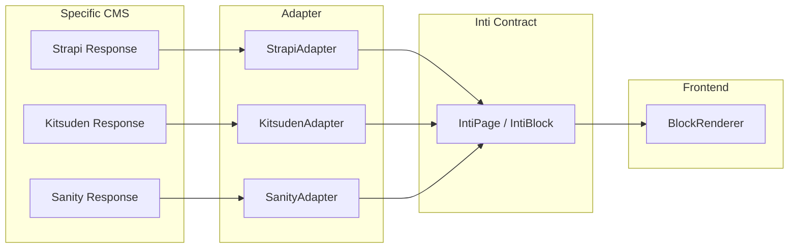

import { Code } from '@astrojs/starlight/components';
import adapterCode from '../../../../../../packages/core/src/adapters/index.ts?raw';

The **agnostic contract** is the foundation of Inti.js: a TypeScript interface that guarantees any CMS can connect in a predictable way.

## The IntiAdapter Interface

<Code code={adapterCode} lang="ts" title="Base Contract (packages/core/src/adapters/index.ts)" />

## Required Methods

### `parsePage(raw: TRawPage): IntiPage`

Transforms the raw CMS response into a standardized page:

```typescript
abstract parsePage(raw: TRawPage): IntiPage;
```

**Input:** CMS response (varies by platform)  
**Output:** structured `IntiPage`

```typescript
interface IntiPage {
  id: string;           // Unique ID
  slug: string;         // Friendly URL
  title: string;        // Page title
  blocks: IntiBlock[];  // Structured content
  seo?: {               // Optional metadata
    title?: string;
    description?: string;
    image?: string;
  };
}
```

### `parseNavigation?(raw: TRawNav): IntiNavigation`

Optional: transforms navigation data:

```typescript
interface IntiNavigation {
  items: IntiNavigationItem[];
}

interface IntiNavigationItem {
  label: string;
  url: string;
  children?: IntiNavigationItem[];
}
```

### `introspect?(): Promise<SchemaDefinition>`

The Inti.js superpower: schema auto-discovery:

```typescript
interface SchemaDefinition {
  source: string;              // CMS name
  version: string;             // Schema version
  collections: SchemaCollection[];
}

interface SchemaCollection {
  name: string;
  description?: string;
  timestamps?: boolean;
  fields: SchemaField[];
}

interface SchemaField {
  name: string;
  type: FieldType;  // 'string' | 'number' | 'boolean' | 'date' | 'json' | 'relation' | 'media'
  required?: boolean;
  description?: string;
  relation?: {
    collection: string;
    multiple?: boolean;
  };
}
```

## Data Flow



## Minimal Implementation

```typescript
import { IntiAdapter } from '@intijs/core/adapters';
import type { IntiPage, IntiBlock } from '@intijs/core';

// CMS response type
interface MyCMSPage {
  sys: { id: string };
  fields: {
    title: string;
    slug: string;
    content: Array<{
      type: string;
      fields: Record<string, any>;
    }>;
  };
}

export class MyCMSAdapter extends IntiAdapter<MyCMSPage> {
  constructor(config: { apiKey: string; spaceId: string }) {
    super('MyCMS', config);
  }

  parsePage(raw: MyCMSPage): IntiPage {
    return {
      id: raw.sys.id,
      slug: raw.fields.slug,
      title: raw.fields.title,
      blocks: raw.fields.content.map((item, index) => ({
        type: item.type,
        id: `${raw.sys.id}-${index}`,
        data: item.fields
      }))
    };
  }
}
```

## Error Handling

The adapter must be resilient:

```typescript
parsePage(raw: unknown): IntiPage {
  try {
    // Basic validation
    if (!raw || typeof raw !== 'object') {
      throw new Error('Invalid response');
    }
    
    // Transformation
    const page = this.transform(raw);
    
    // Required field validation
    if (!page.title) {
      console.warn(`[${this.name}] Missing title, using fallback`);
      page.title = 'Untitled';
    }
    
    return page;
    
  } catch (error) {
    console.error(`[${this.name}Adapter] Error:`, error);
    
    // Graceful fallback
    return {
      id: 'error',
      slug: 'error',
      title: 'Error Loading Page',
      blocks: []
    };
  }
}
```

## Adapter Resolution

Inti.js resolves adapters automatically:

```typescript
// inti.config.ts
export default defineConfig({
  adapter: 'kitsuden',  // Resolves @intijs/adapter-kitsuden
  adapterConfig: { /* ... */ }
});
```

Resolution order:
1. `@intijs/adapter-{name}` - Official
2. `inti-adapter-{name}` - Community
3. Error if not found

## ContentAdapter (Collections)

For "entries"-style content (posts, products, etc.):

```typescript
import { ContentAdapter } from '@intijs/core/adapters';

export class MyCMSContentAdapter extends ContentAdapter {
  sourceName = 'MyCMS';
  
  async fetchRawCollection(collection: string): Promise<any[]> {
    const response = await fetch(
      `${this.config.endpoint}/entries?type=${collection}`
    );
    return response.json();
  }
  
  normalize(raw: any): IntiSchema {
    return {
      id: raw.id,
      type: raw.contentType,
      slug: raw.fields.slug,
      data: raw.fields,
      meta: {
        createdAt: new Date(raw.sys.createdAt),
        updatedAt: new Date(raw.sys.updatedAt),
        source: this.sourceName
      }
    };
  }
}
```
