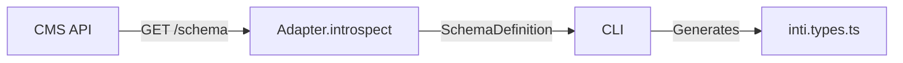

**Introspection** is an adapter's ability to analyze its CMS and describe its data structure. This enables automatic generation of TypeScript types.

## What Is Introspection?



## SchemaDefinition

```typescript
interface SchemaDefinition {
  source: string;           // CMS name
  version: string;          // Schema version
  collections: SchemaCollection[];
}

interface SchemaCollection {
  name: string;             // E.g. "Post", "Product"
  description?: string;
  timestamps?: boolean;     // Automatic createdAt/updatedAt
  fields: SchemaField[];
}

interface SchemaField {
  name: string;             // Field name
  type: FieldType;          // Inti type
  required?: boolean;
  description?: string;
  relation?: {              // Only for type: 'relation'
    collection: string;     // Related collection
    multiple?: boolean;     // One or many
  };
}

type FieldType = 
  | 'string' 
  | 'number' 
  | 'boolean' 
  | 'date' 
  | 'json' 
  | 'relation' 
  | 'media';
```

## Implementation

### Example: Kitsuden

The builder palette (`GET /block-types`) is the same one the panel sees, so
the generated schema and the editor cannot disagree:

```typescript
async introspect(): Promise<SchemaDefinition> {
  // 1. The palette: one block type per entry, with its field schema
  const types = await this.blockTypes();

  // 2. The page, plus one collection per block type
  const collections: SchemaCollection[] = [
    {
      name: 'Page',
      timestamps: true,
      fields: [
        { name: 'title', type: 'string', required: true },
        { name: 'slug', type: 'string', required: true },
        { name: 'blocks', type: 'blocks' }
        // …metaTitle, metaDescription, ogImageId, status
      ]
    },
    ...types.map((blockType) => ({
      name: `${toPascal(blockType.type)}Block`,
      description: blockType.description ?? blockType.name,
      fields: schemaFields(blockType.schema)
    }))
  ];

  return { source: 'kitsuden', version: 'page-builder/v1', collections };
}
```

Kitsuden field types are mapped to Inti's: `enum` is a string
with options (Inti has no type of its own for it), and `object`, `array` and anything
unknown fall back to `json`.

## Type Generation

`inti sync` turns the `SchemaDefinition` into `inti.types.ts`: one interface per collection, plus `IntiTypedBlock`, which types a page's blocks by their `type`. See [Type Generation](/cli/typegen/).

### `blockType`: so blocks can be typed

If a collection describes a block type, declare in `blockType` the `IntiBlock.type` that your `parsePage` assigns to those blocks:

```ts
{
  name: 'HeroBlock',      // TypeScript identifier
  blockType: 'hero',      // the `type` that parsePage returns
  fields: [/* ... */]
}
```

The collection name cannot do that job: it is a TypeScript identifier and the transformation from `type` is not reversible (`tier-list` → `TierListBlock`). Without `blockType`, the collection generates its interface but is left out of `IntiTypedBlock`.

Kitsuden and WordPress already declare it. If you write an adapter, the test that matters is that each collection's `blockType` matches the `type` that `parsePage` assigns to those blocks.

## Mock Schema (Development)

For offline development:

```typescript
// src/mocks/schema.ts
export const mockSchema: SchemaDefinition = {
  source: 'kitsuden',
  version: 'page-builder/v1',
  collections: [
    {
      name: 'Post',
      fields: [
        { name: 'title', type: 'string', required: true },
        { name: 'slug', type: 'string', required: true },
        { name: 'content', type: 'string', required: true },
        { name: 'publishedAt', type: 'date' },
        { name: 'author', type: 'relation', relation: { collection: 'Author', multiple: false } }
      ]
    }
  ]
};

// In the adapter
async introspect(): Promise<SchemaDefinition> {
  if (process.env.MOCK_CMS === 'true') {
    return mockSchema;
  }
  // ... real fetch
}
```

## Testing Introspection

```typescript
import { describe, it, expect } from 'bun:test';
import { KitsudenAdapter } from '@intijs/adapter-kitsuden';

describe('introspection', () => {
  it('returns valid schema definition', async () => {
    const adapter = new KitsudenAdapter({
      endpoint: process.env.INTI_KITSUDEN_ENDPOINT!,
      token: process.env.INTI_KITSUDEN_TOKEN! // kitsuden_agent_…
    });
    
    const schema = await adapter.introspect();
    
    expect(schema.source).toBe('kitsuden');
    expect(schema.version).toBe('page-builder/v1');
    expect(schema.collections).toBeArray();
    expect(schema.collections[0]).toHaveProperty('name');
    expect(schema.collections[0]).toHaveProperty('fields');
  });
  
  it('all fields have valid types', async () => {
    const schema = await adapter.introspect();
    const validTypes = ['string', 'number', 'boolean', 'date', 'json', 'relation', 'media'];
    
    for (const collection of schema.collections) {
      for (const field of collection.fields) {
        expect(validTypes).toContain(field.type);
      }
    }
  });
});
```
