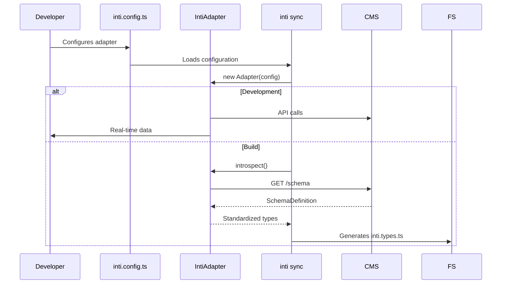

import { Code } from '@astrojs/starlight/components';

## Overview

Inti.js is made of several layers that work together to provide a unified development experience:

```
┌─────────────────────────────────────────────────────────────────┐
│                        FRONTEND LAYER                            │
│  ┌─────────────┐  ┌─────────────┐  ┌─────────────────────────┐  │
│  │   Astro     │  │   Svelte    │  │    BlockRenderer        │  │
│  │ Components  │  │ Components  │  │    (Orchestrator)       │  │
│  └──────┬──────┘  └──────┬──────┘  └───────────┬─────────────┘  │
└─────────┼────────────────┼─────────────────────┼────────────────┘
          │                │                     │
          └────────────────┴─────────────────────┘
                           │
┌──────────────────────────┼──────────────────────────────────────┐
│                    CORE LAYER                                    │
│  ┌───────────────────────┼──────────────────────────────────┐  │
│  │                       ▼                                  │  │
│  │              ┌─────────────────┐                        │  │
│  │              │ Component       │                        │  │
│  │              │ Registry        │                        │  │
│  │              └────────┬────────┘                        │  │
│  │                       │                                  │  │
│  │  ┌────────────────────┼────────────────────┐            │  │
│  │  │                    │                    │            │  │
│  │  ▼                    ▼                    ▼            │  │
│  │ ┌──────┐         ┌────────┐          ┌─────────┐       │  │
│  │ │Types │         │Adapter │          │ Runtime │       │  │
│  │ │      │         │        │          │         │       │  │
│  │ └──────┘         └────────┘          └─────────┘       │  │
│  │    │                   │                   │            │  │
│  └────┼───────────────────┼───────────────────┼────────────┘  │
       │                   │                   │
       └───────────────────┼───────────────────┘
                           │
┌──────────────────────────┼──────────────────────────────────────┐
│                   ADAPTER LAYER                                  │
│  ┌─────────────┐  ┌──────┴──────┐  ┌─────────────────────────┐  │
│  │  Kitsuden    │  │   Strapi    │  │     Custom CMS          │  │
│  │  Adapter    │  │   Adapter   │  │     Adapter             │  │
│  └──────┬──────┘  └──────┬──────┘  └───────────┬─────────────┘  │
└─────────┼────────────────┼─────────────────────┼────────────────┘
          │                │                     │
          └────────────────┴─────────────────────┘
                           │
                    ┌──────┴──────┐
                    │   CMS APIs  │
                    └─────────────┘
```

## Core Package (`@intijs/core`)

### Modules

```typescript
// @intijs/core - Main export
export * from './types/index.js';
export * from './adapters/index.js';
export * from './registry/index.js';
export * from './runtime/index.js';

// Integrations
export * from './astro/index.js';
```

### Responsibilities

| Module | Responsibility |
|--------|-----------------|
| `types` | TypeScript definitions of the agnostic contract |
| `adapters` | Base classes for CMS adapters |
| `registry` | Component registration system |
| `runtime` | Runtime functions |
| `astro` | Astro-specific integrations |

## CLI Package (`@intijs/cli`)

### Commands

```bash
inti sync [options]
  --force        # Ignore cache
  --watch        # Watch mode
  --types-only   # Only generate types
  --output       # Output directory
```

### Generation Flow

```
1. Load inti.config.ts
2. Resolve adapter
3. Call adapter.introspect()
4. Generate types (TypeScript)
5. Generate SDK (typed functions)
6. Write files
```

## Adapter Package (`@intijs/adapter-*`)

### Contract

Every adapter must implement:

```typescript
abstract class IntiAdapter<TRawPage, TRawNav> {
  // Required
  abstract parsePage(raw: TRawPage): IntiPage;
  
  // Optional but recommended
  abstract parseNavigation?(raw: TRawNav): IntiNavigation;
  abstract introspect?(): Promise<SchemaDefinition>;
}
```

### Lifecycle



## Component Registry

### Data Structure

```typescript
class ComponentRegistry {
  private registry = new Map<string, BlockRegistration>();
  
  register(blockType: string, registration: BlockRegistration)
  get(blockType: string): BlockRegistration | undefined
  has(blockType: string): boolean
}
```

### Global Singleton

```typescript
const _global = globalThis as any;
if (!_global.__intiComponentRegistry) {
  _global.__intiComponentRegistry = new ComponentRegistry();
}
export const registry = _global.__intiComponentRegistry;
```

This allows:
- Sharing the registry between modules
- Persistence across HMR
- Access from any file

## Data Flow

### Page Rendering

```
1. A request reaches Astro
2. Adapter.fetch() gets data from the CMS
3. Adapter.parsePage() normalizes it to IntiPage
4. BlockRenderer iterates over blocks
5. For each block:
   a. registry.get(block.type)
   b. Loads the component dynamically
   c. Renders it with props
6. Astro sends HTML to the client
```

### Schema Sync

```
1. The developer runs `inti sync`
2. The CLI loads the configured adapter
3. Adapter.introspect() fetches the schema from the CMS
4. The schema is normalized to SchemaDefinition
5. CodeGenerator creates:
   - TypeScript interfaces
   - Typed SDK functions
6. Files are written to disk
7. TypeScript validates the code
```

## Extension Points

### Creating an Adapter

```typescript
import { IntiAdapter } from '@intijs/core/adapters';

export class MyAdapter extends IntiAdapter {
  parsePage(raw) { /* ... */ }
  introspect() { /* ... */ }
}
```

### Creating a Plugin

```typescript
// inti.config.ts
export default defineConfig({
  adapter: 'kitsuden',
  plugins: [
    {
      name: 'analytics',
      beforeSync: async () => { /* ... */ },
      afterSync: async (schema) => { /* ... */ }
    }
  ]
});
```

## Performance Considerations

### Lazy Loading

```typescript
// ✅ Components load on demand
registry.register('heavy', {
  component: () => import('./Heavy.svelte')
});
```

### Caching

```typescript
// An adapter can implement a cache
class CachedAdapter extends IntiAdapter {
  private cache = new Map();
  
  async fetchPage(slug: string) {
    if (this.cache.has(slug)) {
      return this.cache.get(slug);
    }
    const data = await super.fetchPage(slug);
    this.cache.set(slug, data);
    return data;
  }
}
```

### Bundle Size

- `@intijs/core`: ~5KB (runtime)
- `@intijs/cli`: ~50KB (dev dependency)
- Adapters: ~2-10KB each
- Generated SDK: ~1KB per collection

## Security

### Environment Variables

```typescript
// inti.config.ts - Never expose tokens
export default defineConfig({
  adapterConfig: {
    token: process.env.CMS_TOKEN // ✅
    // token: 'abc123' // ❌ NEVER
  }
});
```

### Data Validation

```typescript
// An adapter must validate its input
parsePage(raw: unknown): IntiPage {
  if (!raw || typeof raw !== 'object') {
    throw new Error('Invalid response');
  }
  // ...
}
```
