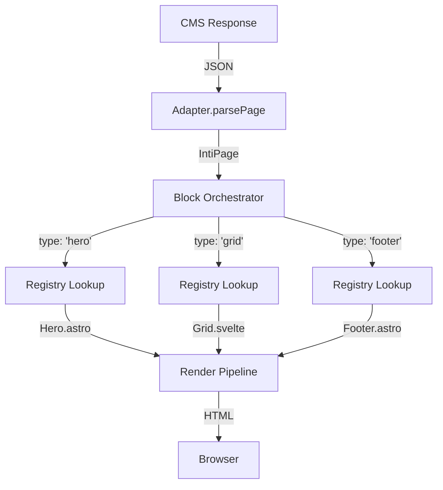

import { Code } from '@astrojs/starlight/components';
import adapterCode from '../../../../../../packages/core/src/adapters/index.ts?raw';

The **Block Orchestrator** is the system that turns raw data from any CMS into renderable components, staying type-safe from end to end.

## How Does It Work?



## The IntiBlock Structure

All content in Inti.js is normalized into standardized blocks:

```typescript
interface IntiBlock {
  type: string;           // Component identifier (e.g., 'hero-banner')
  id?: string;           // Optional unique ID
  data: Record<string, any>;  // Block-specific data
}
```

### Transformation Example

**Input (Kitsuden CMS):** a `block_contents` row, with its uuid and its
position within the page.
```json
{
  "id": "b1",
  "type": "hero",
  "name": "Cover",
  "sortOrder": 0,
  "content": { "headline": "Welcome", "mediaId": "aaaa-bbbb" }
}
```

**Output (normalized IntiBlock):**
```typescript
{
  type: "hero",
  id: "b1",
  data: { headline: "Welcome", mediaId: "aaaa-bbbb" },
  meta: { index: 0, total: 2, label: "Cover" }
}
```

## The Adapter as Translator

The adapter is responsible for this transformation:

<Code code={adapterCode} lang="ts" title="packages/core/src/adapters/index.ts" />

## Component Registry

The registry maps each block type to its component. The usual approach is to register a whole folder, where the file name is the type:

```ts
import { registerBlocks } from '@intijs/core/registry';

registerBlocks(import.meta.glob('/src/blocks/*.astro'));
// src/blocks/HeroBanner.astro → type 'HeroBanner'
```

Details and per-CMS conventions in [Component Registry](/registry/components/).

## BlockRenderer

It ships with Inti; you do not have to write it. It receives the list of blocks, looks up each block's component, passes it the block's data as props and wraps it with what the editor needs to know where to write:

```astro
---
import BlockRenderer from '@intijs/core/astro/BlockRenderer.astro';
---
<BlockRenderer blocks={page.blocks} page={page} />
```

Full reference in [BlockRenderer](/registry/block-renderer/).

## Full Pipeline

```astro
---
// src/pages/[...slug].astro
import { WordPressAdapter } from '@intijs/adapter-wordpress';
import { registerBlocks } from '@intijs/core/registry';
import BlockRenderer from '@intijs/core/astro/BlockRenderer.astro';
import VisualBridgeAuto from '@intijs/core/visual-bridge/VisualBridgeAuto.astro';

registerBlocks(import.meta.glob('/src/blocks/*.astro'));

const adapter = new WordPressAdapter({ endpoint: import.meta.env.INTI_WP_ENDPOINT });
const page = await adapter.fetchPageBySlug(Astro.params.slug ?? 'home');
---

<main>
  <BlockRenderer blocks={page.blocks} page={page} />
</main>
<VisualBridgeAuto />
```

1. The **adapter** reads the page from the CMS and turns it into `IntiBlock[]`.
2. **`BlockRenderer`** paints each block with its component.
3. **`VisualBridgeAuto`** turns on the editor in development: double-click, edit, save to the CMS.

## Advantages of the Approach

| Aspect | Benefit |
|---------|-----------|
| **Type-safe** | Data is validated in the adapter |
| **Decoupled** | Switch the CMS without touching components |
| **Lazy loading** | Only the needed components are loaded |
| **Selective hydration** | Full control over interactivity |
| **Fallbacks** | Graceful handling of unknown blocks |
